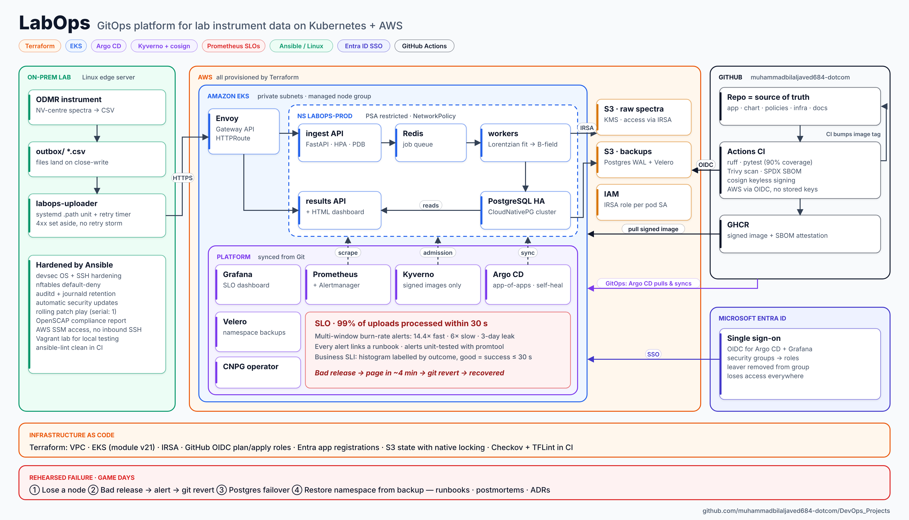
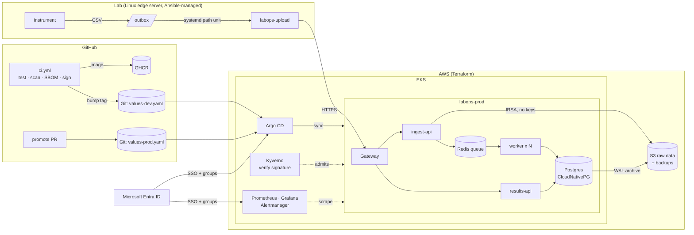

# LabOps

**A production-style platform for processing scientific measurement data, built, secured, monitored and recovered entirely from code.**

Instruments in a lab produce spectra (here: optically detected magnetic resonance from NV centres in diamond). A hardened Linux edge server ships them to a Kubernetes platform on AWS, which fits the resonance dips, derives the magnetic field, and serves the results. Everything around that small app is the point of the project: infrastructure as code, GitOps delivery, supply-chain security, identity, SLO-based alerting, and rehearsed failure.

> I built this because I used to take these measurements by hand during my MSc in photonics. The physics is real; the platform is how a company would run it.

<!-- Replace with your own screenshots/GIF once deployed: docs/img/*.png -->
| Argo CD | Grafana SLO dashboard | Bad release caught and rolled back |
|---|---|---|
| _screenshot_ | _screenshot_ | _GIF_ |

---

## What this demonstrates

| Area | What's in the repo | Where |
|---|---|---|
| Infrastructure as code | VPC, EKS (AL2023, access entries, KMS, audit logs), IRSA roles, S3, budget alarm. Remote state with S3-native locking | `infra/terraform` |
| CI/CD | Lint, tests (80% coverage gate), build, **blocking** CVE scan, SBOM, keyless signing; actions pinned by SHA | `.github/workflows/ci.yml` |
| GitOps | Argo CD app-of-apps, dev auto-sync, prod only via reviewed PR inside a sync window; rollback = `git revert` | `deploy/argocd` |
| Kubernetes | Helm chart: probes done right, PDBs, topology spread, HPA, NetworkPolicies, restricted pod security | `deploy/helm/labops` |
| Policy as code | Kyverno CEL policies (`ImageValidatingPolicy`, `ValidatingPolicy`): only images **signed by this repo's CI** run; no `:latest`; limits required. Restricted PSS via native Pod Security Admission. Policies have unit tests | `deploy/policies` |
| Observability | Multi-window, multi-burn-rate SLO alerts (Google SRE Workbook), recording rules, Grafana dashboard, runbook links on every alert. Alerts are unit-tested with `promtool` in CI | `templates/prometheusrule.yaml`, `deploy/monitoring/tests` |
| Data & DR | CloudNativePG (HA Postgres, failover, S3 PITR backups), Velero namespace backups, timed restore drill | `templates/postgres.yaml`, `chaos/` |
| Identity | Microsoft Entra ID SSO for Argo CD and Grafana; access by Entra group, managed with Terraform | `infra/terraform/modules/entra-sso` |
| Linux administration | Ansible: CIS-style hardening, nftables, auditd, journald, auto-patching, rolling patch play, OpenSCAP before/after scan, systemd-sandboxed uploader | `ansible/` |
| Reliability practice | Four scripted game days with written postmortems | `chaos/`, `docs/game-days` |
| Cost | Spot nodes, single NAT, lifecycle rules, budget alarm, `make aws-down` | `docs/cost.md` |

## Architecture



The same flow as a diagram GitHub renders natively:



More detail: [docs/architecture.md](docs/architecture.md) · design decisions: [docs/adr](docs/adr)

## The SLO

> **99% of uploaded spectra have a result within 30 seconds**, measured over 30 days.

The worker records upload→result time per job; a job counts as good only if it **succeeded** and finished within 30 s. Alerts page on a 14.4× burn over 1 h (budget gone in ~2 days) or 6× over 6 h, and open a ticket on a slow 3-day leak. Every alert links to a runbook in [docs/runbooks](docs/runbooks).

## Game days (results)

Fill this table with your own numbers; this is the part interviewers ask about.

| # | Scenario | Hypothesis | Result | Postmortem |
|---|---|---|---|---|
| 1 | Lose a node | No failed uploads, SLO unaffected | _TODO: pods rescheduled in X s, Y failed jobs_ | _link_ |
| 2 | Bad release (50% job failures) | Fast-burn alert in < 5 min; `git revert` restores service | _TODO: detected in X min, MTTR Y min_ | _link_ |
| 3 | Kill Postgres primary | Failover < 30 s, no data loss | _TODO_ | _link_ |
| 4 | Delete prod namespace | Restore from backup; RTO measured | _TODO: RTO = X min_ | _link_ |

## Run it

**Locally, free (laptop with Docker):**
```bash
make dev        # docker compose: 3 app roles + Postgres + Redis
make demo       # upload 20 synthetic spectra
open http://localhost:8001
```

**Local Kubernetes (kind), free:**
```bash
make kind-up        # same Helm chart as production
make kind-gitops    # or: Argo CD + Kyverno + monitoring, all from Git
```

**AWS** (≈ USD 6–8 per day while running; destroy afterwards). Step-by-step in [docs/setup.md](docs/setup.md):
```bash
make tf-init TF_STATE_BUCKET=labops-tfstate-<account-id>
make tf-apply && make eks-bootstrap
# ... demo, game days, screenshots ...
make aws-down
```

**Linux edge server** (Vagrant VM, free):
```bash
make edge-up && make edge-scan    # CIS score BEFORE
make edge-harden && make edge-scan # CIS score AFTER
```

## Repository map

```
app/                 Python service (FastAPI, worker), tests, Dockerfile
deploy/helm/labops   Helm chart (dev/prod values)
deploy/argocd        App-of-apps, projects, platform add-ons
deploy/policies      Kyverno policies + policy tests
infra/terraform      bootstrap, modules (network, eks, app-iam, github-oidc, entra-sso), envs
ansible/             Lab-edge hardening, patching, compliance scanning
chaos/               Game-day scripts
docs/                Architecture, ADRs, runbooks, postmortems, setup, interview notes
knowledge-base/      Engineering notes: DevOps lifecycle, Linux, Windows Server, DNS, Robot Fleet Monitoring
```

## Knowledge base

The theory behind this project, written up with architecture diagrams during my DevOps internship and home-lab work:

| Notes | Topics |
|---|---|
| [DevOps Course Notes](knowledge-base/01-devops-course-notes.md) | Git, Jenkins CI/CD, Docker, Kubernetes, Helm, Terraform on AWS, Ansible, monitoring, GitOps, DevSecOps, deployment strategies |
| [Linux Administration](knowledge-base/02-linux-administration.md) | Boot, permissions, systemd, logging, LVM, networking, firewalls, SSH, backups, NFS/Samba |
| [Windows Server Administration](knowledge-base/03-windows-server-administration.md) | Active Directory, Group Policy, DNS, DHCP, NTFS and FSRM, disaster recovery |
| [Robot Fleet Monitoring](knowledge-base/04-robot-fleet-monitoring.md) | Python telemetry → Prometheus → Grafana with Docker Compose |
| [How DNS Works](knowledge-base/05-how-dns-works.md) | Resolution, records, TTL, Route 53, CoreDNS, AD DNS, troubleshooting |

## Honest limitations

- Dev and prod share one EKS cluster (separate namespaces) to keep cost down. A real company would separate them by cluster and AWS account; see [ADR 0003](docs/adr/0003-one-cluster-two-namespaces.md).
- Redis is a single in-cluster pod; losing it loses queued jobs (they stay "queued" in the DB and need a re-enqueue, see runbook). A managed queue (SQS) would remove this.
- The Terraform apply role has broad permissions, constrained by *who* can assume it (approved GitHub Environment) rather than by a narrow policy. A permissions boundary would be the next step.

## License

MIT
