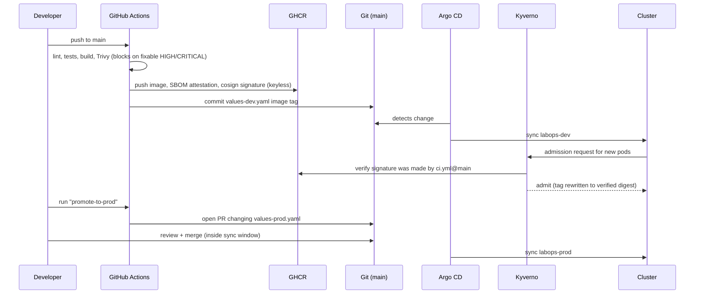

# Architecture

## Request flow

1. An instrument writes `spectrum.csv` into `/srv/instrument/outbox` on the lab-edge server.
2. A systemd **path unit** fires when the file is closed and runs `labops-upload`, which POSTs it to `https://<host>/api/v1/uploads`. Network errors leave the file for a 5-minute retry timer; a `4xx` moves it to `failed/` for a human.
3. The Envoy **Gateway** routes `POST /api/v1/uploads` to **ingest-api** and everything else to **results-api**.
4. ingest-api validates the CSV (rejects garbage with `422` before it costs anything), stores the raw file (S3 in prod, a Postgres table in dev), creates a `measurements` row with status `queued`, and pushes a job onto the **Redis** list.
5. A **worker** pops the job, fits Lorentzian dips (SciPy), derives the field `B = Δf / 2γ`, writes the result, and records the upload→result time — the SLI.
6. **results-api** serves JSON and a small HTML dashboard from Postgres.

## Why three roles from one image

One codebase and one image means one build, one scan, one signature, one SBOM. The Deployment picks the role with its `command`. The roles scale differently (the worker is CPU-bound and has an HPA; the APIs are light), which is the real reason to split them.

## Delivery flow

## Trust boundaries and secrets

| Secret / credential | Where it lives | Never in |
|---|---|---|
| AWS access for Terraform in CI | Short-lived OIDC session (GitHub → IAM role) | Git, GitHub secrets |
| AWS access for app pods | IRSA: projected token → IAM role scoped to one service account | Env vars, images |
| Postgres password | Generated by CloudNativePG into a Kubernetes Secret | Git, values files |
| Image signing | Keyless (Sigstore Fulcio cert bound to the workflow identity) | Any long-lived key |
| Entra SSO client secrets | Terraform state → `scripts/entra-secrets.sh` → Kubernetes Secret | Git |

## Network

- Nodes run in private subnets; only the Gateway's load balancer is public.
- The Kubernetes API is public but limited to the admin's IP (`api_allowed_cidrs`).
- NetworkPolicies (enforced by the VPC CNI) default-deny the app namespace and allow only: Gateway → APIs, Prometheus → metrics, apps → Redis/Postgres/DNS, apps → 443 (S3/STS).
- The lab-edge server accepts SSH (rate-limited) and node_exporter from the monitoring range only; or, on EC2, no inbound at all (Ansible over SSM).
