# 01 · DevOps Course Notes

Complete notes from my DevOps internship (Valaxy Technologies, 2024), organised along the path code takes from a developer's laptop to production.

**Contents**
1. [What DevOps is](#1-what-devops-is)
2. [Git and branching](#2-git-and-branching)
3. [Build tools and artifact repositories](#3-build-tools-and-artifact-repositories)
4. [CI/CD with Jenkins](#4-cicd-with-jenkins)
5. [Docker](#5-docker)
6. [Kubernetes](#6-kubernetes)
7. [Helm](#7-helm)
8. [Terraform on AWS](#8-terraform-on-aws)
9. [Ansible](#9-ansible)
10. [Monitoring and logging](#10-monitoring-and-logging)
11. [GitOps with Argo CD](#11-gitops-with-argo-cd)
12. [DevSecOps](#12-devsecops)
13. [Deployment strategies](#13-deployment-strategies)
14. [Serverless on AWS](#14-serverless-on-aws)
15. [Check yourself](#15-check-yourself)

---

## 1. What DevOps is

DevOps is a way of working that removes the wall between people who **write** software and people who **run** it. The goal is to ship small changes often, safely, and with fast feedback.

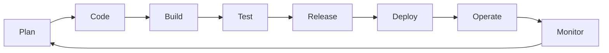

| Principle | In practice |
|---|---|
| Automate everything repeatable | Pipelines, IaC, configuration management |
| Everything as code | App, infra, config, policies and dashboards live in Git |
| Small batches | Short-lived branches, frequent merges |
| Fast feedback | Tests and scans on every commit, alerts on symptoms |
| Shared ownership | "You build it, you run it" |

**Key metrics (DORA):** deployment frequency, lead time for changes, change failure rate, time to restore service.

---

## 2. Git and branching

Git is a distributed version control system: every clone has the full history.

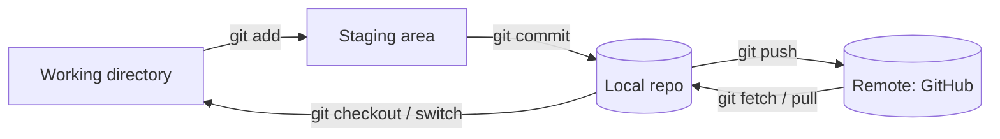

```bash
git clone <url>                 # copy a remote repository
git switch -c feature/login     # create and move to a new branch
git add . && git commit -m "Add login form"
git push -u origin feature/login
git pull --rebase origin main   # update your branch with main, linear history
git log --oneline --graph       # visual history
git revert <sha>                # undo a commit safely (new commit)
git reset --soft HEAD~1         # undo last commit, keep changes staged
git stash / git stash pop       # park work temporarily
```

**Branching strategies**

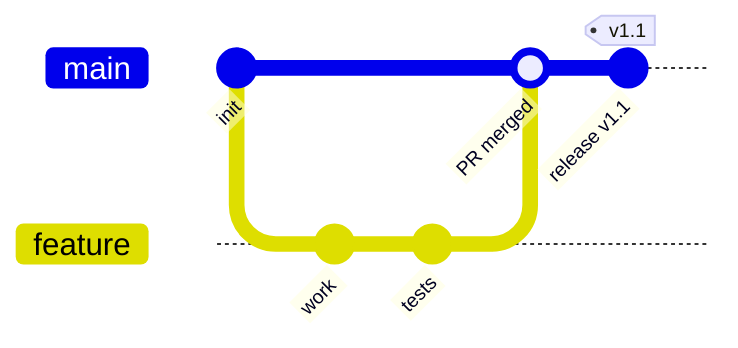

- **Trunk-based**: short branches merged to `main` daily; feature flags hide unfinished work. Preferred for CI/CD.
- **GitFlow**: `develop`, `release/*`, `hotfix/*`; heavier, suits versioned products.
- **merge vs rebase**: merge keeps history as it happened; rebase rewrites your branch on top of `main` for a linear log. Never rebase shared branches.

---

## 3. Build tools and artifact repositories

**Maven** (Java) follows a lifecycle: `validate → compile → test → package → verify → install → deploy`. Configuration lives in `pom.xml`.

```bash
mvn clean package     # compile, test, produce target/*.jar
mvn clean deploy      # also upload the artifact to a repository
```

**Artifact repositories** (JFrog Artifactory, Nexus) store versioned build outputs so the same binary is promoted through every environment, never rebuilt.

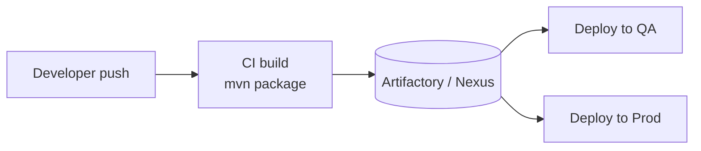

*Rule:* build once, deploy many times.

---

## 4. CI/CD with Jenkins

- **Continuous Integration**: every commit is built and tested automatically.
- **Continuous Delivery**: every passing build is *ready* to deploy (manual approval).
- **Continuous Deployment**: every passing build *is* deployed automatically.

### Jenkins architecture

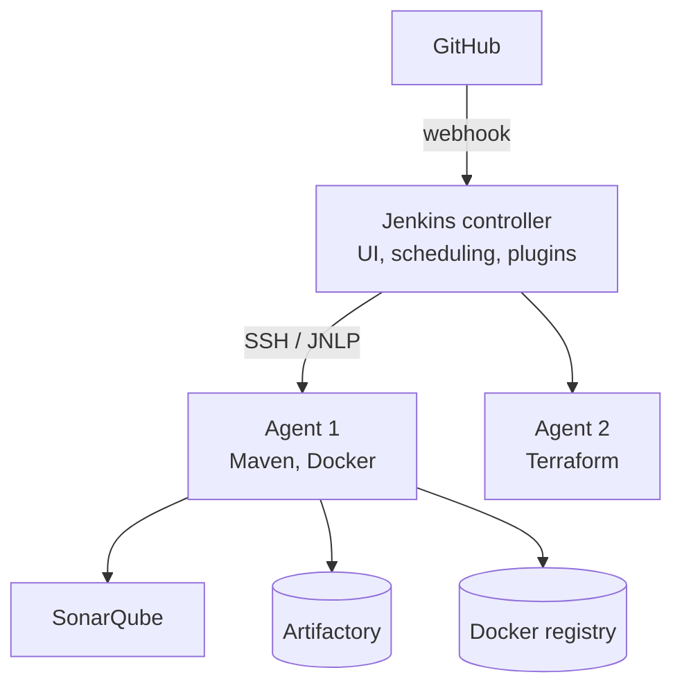

The controller schedules work; agents do the building, so the controller stays light and secure.

### Declarative pipeline (Jenkinsfile)

```groovy
pipeline {
  agent { label 'maven' }
  environment { IMAGE = "myrepo/app:${env.BUILD_NUMBER}" }
  stages {
    stage('Checkout') { steps { git branch: 'main', url: 'https://github.com/org/app.git' } }
    stage('Build')    { steps { sh 'mvn clean package -DskipTests' } }
    stage('Test')     { steps { sh 'mvn test' } post { always { junit 'target/surefire-reports/*.xml' } } }
    stage('Code quality') {
      steps { withSonarQubeEnv('sonar') { sh 'mvn sonar:sonar' } }
    }
    stage('Quality gate') { steps { timeout(time: 5, unit: 'MINUTES') { waitForQualityGate abortPipeline: true } } }
    stage('Publish jar')  { steps { sh 'mvn deploy -DskipTests' } }
    stage('Docker image') { steps { sh 'docker build -t $IMAGE . && docker push $IMAGE' } }
    stage('Deploy')       { steps { sh 'helm upgrade --install app ./chart --set image.tag=$BUILD_NUMBER' } }
  }
  post { failure { echo 'Notify team: build failed' } }
}
```

**Good practice:** credentials in the Jenkins credentials store (never in the Jenkinsfile), shared libraries for reusable steps, pipelines triggered by webhooks not polling.

---

## 5. Docker

A container is a normal Linux process isolated with **namespaces** (what it can see: PID, network, mount, user) and limited with **cgroups** (what it can use: CPU, memory). Unlike a VM it shares the host kernel, so it starts in milliseconds.

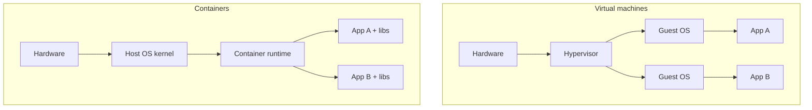

### Image layers and a multi-stage Dockerfile

```dockerfile
# Stage 1: build
FROM maven:3.9-eclipse-temurin-17 AS build
WORKDIR /src
COPY pom.xml .
RUN mvn dependency:go-offline        # cached layer while pom.xml is unchanged
COPY src ./src
RUN mvn package -DskipTests

# Stage 2: small runtime image
FROM eclipse-temurin:17-jre-alpine
RUN addgroup -S app && adduser -S app -G app
USER app                              # never run as root
COPY --from=build /src/target/app.jar /app/app.jar
EXPOSE 8080
ENTRYPOINT ["java", "-jar", "/app/app.jar"]
```

Each instruction creates a cached layer; put rarely changing steps first.

```bash
docker build -t app:1.0 .
docker run -d --name app -p 8080:8080 app:1.0
docker ps / docker logs -f app / docker exec -it app sh
docker volume create data            # persistent storage
docker network create backend        # containers on it resolve each other by name
docker compose up -d                 # multi-container apps from docker-compose.yml
```

| Network driver | Use |
|---|---|
| bridge | Default, containers on one host |
| host | Shares host network stack, no isolation |
| overlay | Spans hosts (Swarm) |
| none | No networking |

---

## 6. Kubernetes

Kubernetes keeps the **actual state** of the cluster equal to the **desired state** you declare in YAML. Controllers loop forever: observe, compare, act.

### Cluster architecture

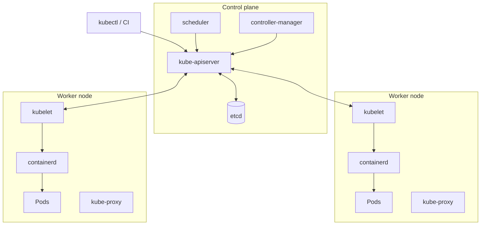

| Component | Job |
|---|---|
| kube-apiserver | Front door; every change goes through it |
| etcd | Key-value store holding the cluster state |
| scheduler | Picks a node for each new Pod |
| controller-manager | Runs controllers (Deployment, ReplicaSet, Node…) |
| kubelet | Agent on each node; starts and health-checks containers |
| kube-proxy | Programs node networking for Services |

### Core objects

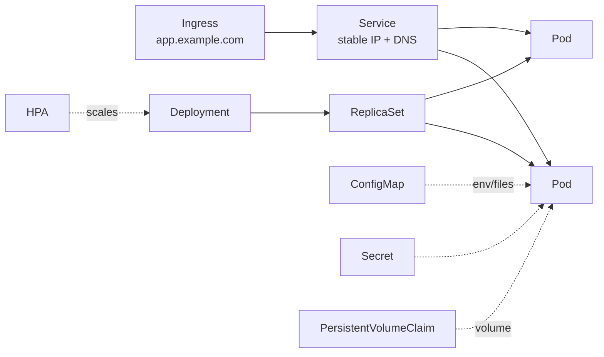

```yaml
apiVersion: apps/v1
kind: Deployment
metadata: { name: web, namespace: shop }
spec:
  replicas: 3
  selector: { matchLabels: { app: web } }
  template:
    metadata: { labels: { app: web } }
    spec:
      containers:
        - name: web
          image: myrepo/web:1.4.2
          ports: [{ containerPort: 8080 }]
          resources:
            requests: { cpu: 100m, memory: 128Mi }   # used for scheduling
            limits:   { cpu: 500m, memory: 256Mi }   # hard cap
          readinessProbe: { httpGet: { path: /ready, port: 8080 } }   # receive traffic?
          livenessProbe:  { httpGet: { path: /health, port: 8080 } }  # restart me?
---
apiVersion: v1
kind: Service
metadata: { name: web, namespace: shop }
spec:
  selector: { app: web }
  ports: [{ port: 80, targetPort: 8080 }]
  type: ClusterIP
```

**Service types:** `ClusterIP` (inside cluster), `NodePort` (port on every node), `LoadBalancer` (cloud LB), `ExternalName` (DNS alias).

### Scheduling and scaling

- **Namespaces** separate teams/environments; quotas and RBAC apply per namespace.
- **HPA** adds/removes Pods based on CPU, memory or custom metrics (needs metrics-server).
- **Taints and tolerations**: a taint on a node repels Pods; only Pods with a matching toleration can land there (e.g. GPU nodes).
- **Node affinity**: Pod *wants* nodes with certain labels. **Pod anti-affinity**: spread replicas across nodes/zones.
- **Ingress + Ingress Controller** (e.g. NGINX): one load balancer routing many hostnames/paths to Services.
- **RBAC**: `Role`/`ClusterRole` define verbs on resources; `RoleBinding` grants them to a user, group or ServiceAccount.

```bash
kubectl get pods -n shop -o wide
kubectl describe pod <pod>            # events explain most failures
kubectl logs <pod> -c web --previous  # logs of the crashed container
kubectl rollout status deploy/web
kubectl rollout undo deploy/web       # rollback
kubectl autoscale deploy web --cpu-percent=70 --min=2 --max=10
kubectl auth can-i delete pods --as system:serviceaccount:shop:ci
```

**Debugging order:** `get` → `describe` (events) → `logs` → `exec` → check Service endpoints → check NetworkPolicy/DNS.

---

## 7. Helm

Helm is the package manager for Kubernetes. A **chart** is templated YAML plus default `values.yaml`; a **release** is an installed instance.

```bash
helm create mychart
helm install web ./mychart -f values-prod.yaml -n shop
helm upgrade web ./mychart --set image.tag=1.4.3
helm history web && helm rollback web 2
helm template ./mychart | less       # render without installing
```

One chart, many environments: only the values file changes.

---

## 8. Terraform on AWS

Terraform describes infrastructure declaratively. It compares your code with the **state file** and the real cloud, then plans the difference.

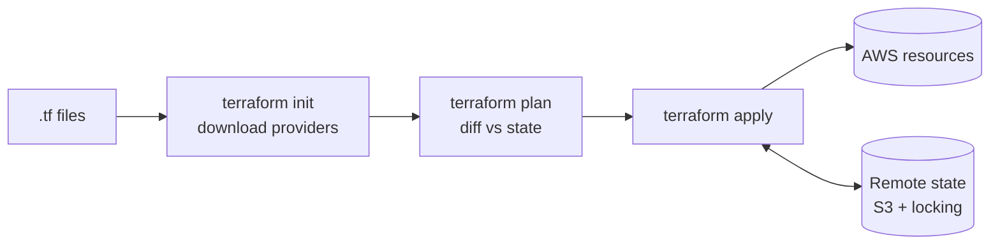

### Custom VPC I built

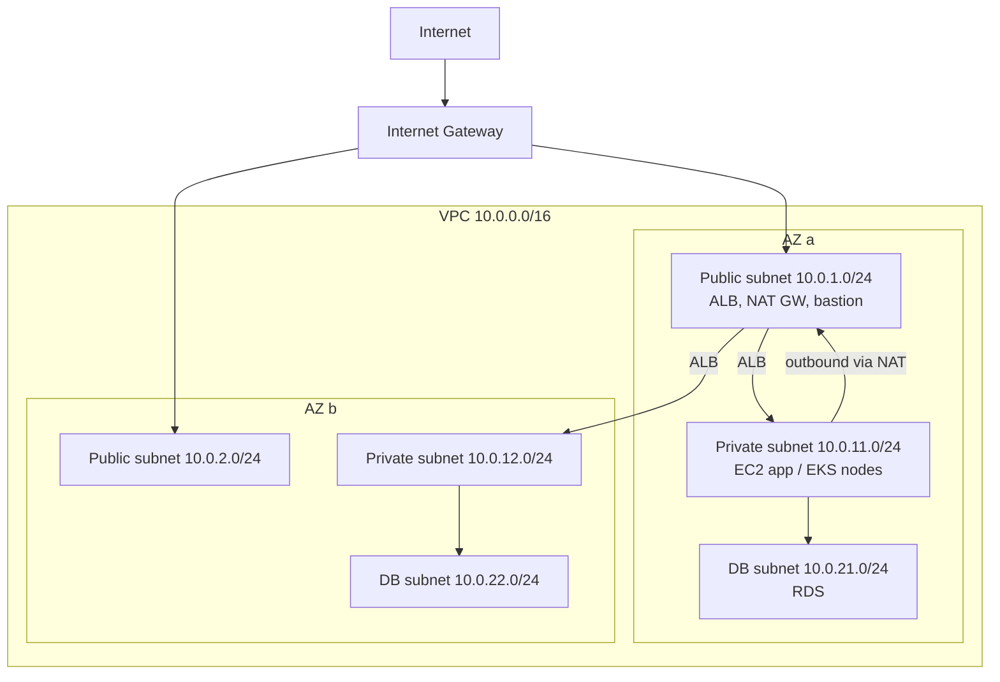

- Public route table: `0.0.0.0/0 → IGW`. Private route table: `0.0.0.0/0 → NAT gateway`.
- Security groups are stateful and attach to instances; NACLs are stateless and attach to subnets.
- Auto Scaling Group behind an Application Load Balancer spreads instances across AZs.

```hcl
terraform {
  backend "s3" {
    bucket       = "my-tf-state"
    key          = "network/terraform.tfstate"
    region       = "eu-central-1"
    use_lockfile = true      # S3-native state locking
  }
}

module "vpc" {
  source = "./modules/vpc"            # local module
  cidr   = "10.0.0.0/16"
  azs    = ["eu-central-1a", "eu-central-1b"]
}

resource "aws_s3_bucket" "logs" {
  bucket = "app-logs-${var.env}"
  tags   = { Environment = var.env }
}

output "vpc_id" { value = module.vpc.vpc_id }
```

| Concept | Meaning |
|---|---|
| Provider | Plugin that talks to an API (aws, kubernetes…) |
| Resource / data source | Thing Terraform manages / thing it only reads |
| Variables / outputs | Inputs and return values of a module |
| Module | Reusable folder of .tf files (local or from the registry) |
| State | Terraform's record of what it created; keep it remote and locked |
| Workspaces / env folders | Separate states per environment |

Other AWS services practised: EC2, IAM (least-privilege roles), S3, RDS, Route 53, CloudWatch, Lambda, EKS, ELB/ALB, Auto Scaling.

---

## 9. Ansible

Agentless configuration management over SSH. Playbooks are **idempotent**: running them twice changes nothing the second time.

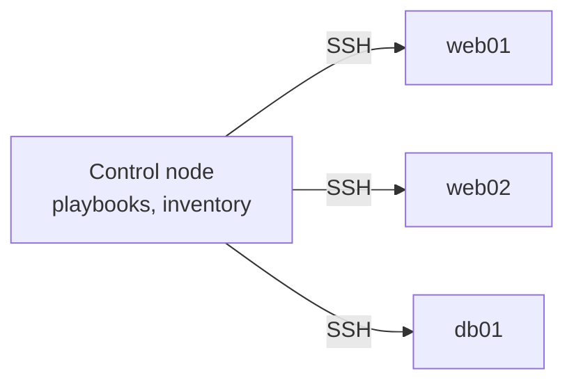

```yaml
# site.yml
- hosts: web
  become: true
  vars: { pkg: nginx }
  tasks:
    - name: Install nginx
      ansible.builtin.package: { name: "{{ pkg }}", state: present }
    - name: Deploy config
      ansible.builtin.template: { src: nginx.conf.j2, dest: /etc/nginx/nginx.conf }
      notify: restart nginx
  handlers:
    - name: restart nginx
      ansible.builtin.service: { name: nginx, state: restarted }
```

```bash
ansible all -i inventory.ini -m ping
ansible-playbook -i inventory.ini site.yml --check --diff   # dry run
```

**Memory hook:** *inventory* = who, *playbook* = what, *module* = how, *handler* = only if something changed, *role* = reusable bundle.

---

## 10. Monitoring and logging

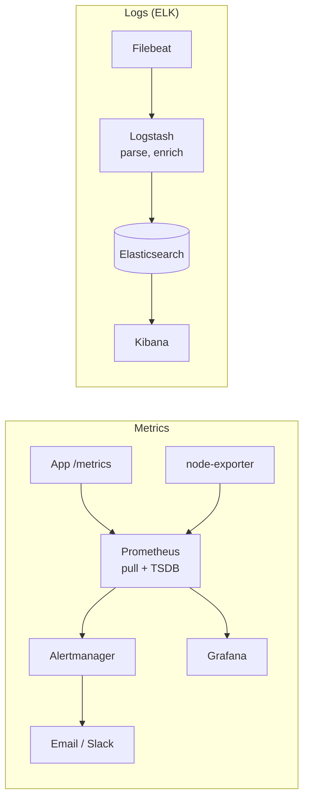

- **Prometheus** scrapes metrics over HTTP. Types: counter, gauge, histogram, summary. Queried with PromQL.
- **Grafana** builds dashboards over Prometheus, Elasticsearch, CloudWatch and more.
- **ELK**: ship, parse and search logs centrally.
- **Golden signals**: latency, traffic, errors, saturation.

```promql
rate(http_requests_total{status=~"5.."}[5m]) / rate(http_requests_total[5m])   # error ratio
histogram_quantile(0.95, sum(rate(http_request_duration_seconds_bucket[5m])) by (le))  # p95 latency
```

**SLO alerting:** alert when the error budget is burning fast (symptoms users feel), not on every CPU spike.

---

## 11. GitOps with Argo CD

Git is the single source of truth. Argo CD runs **inside** the cluster and pulls the desired state, so CI never needs cluster credentials.

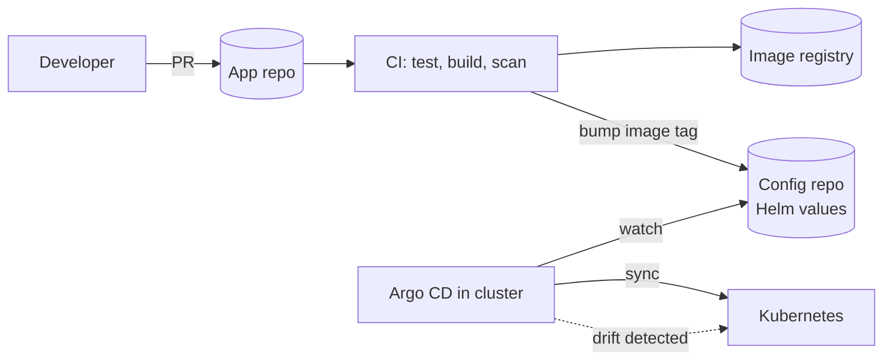

Benefits: full audit trail, rollback with `git revert`, drift detection and self-healing.

---

## 12. DevSecOps

Shift security left: find problems in the pipeline, not in production.

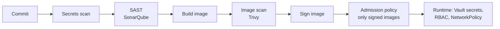

- **SonarQube**: bugs, code smells, coverage, quality gate.
- **Trivy**: CVEs in images, filesystems and IaC; fail the build on HIGH/CRITICAL.
- **HashiCorp Vault**: central secrets with short-lived dynamic credentials and audit logs.
- **Least privilege** everywhere: IAM roles, Kubernetes RBAC, non-root containers.

---

## 13. Deployment strategies

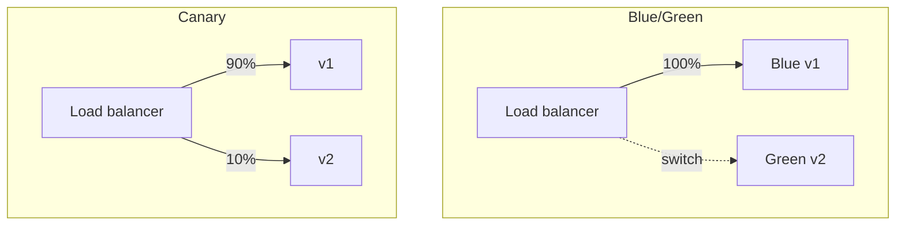

| Strategy | How | Pros | Cons |
|---|---|---|---|
| Recreate | Stop v1, start v2 | Simple | Downtime |
| Rolling update | Replace Pods gradually (K8s default) | No downtime, no extra cost | Two versions live at once |
| Blue/Green | Full new stack, switch traffic at once | Instant rollback | Double resources |
| Canary | Small % of traffic to v2, grow if healthy | Lowest risk, real-user testing | Needs good metrics and routing |

---

## 14. Serverless on AWS

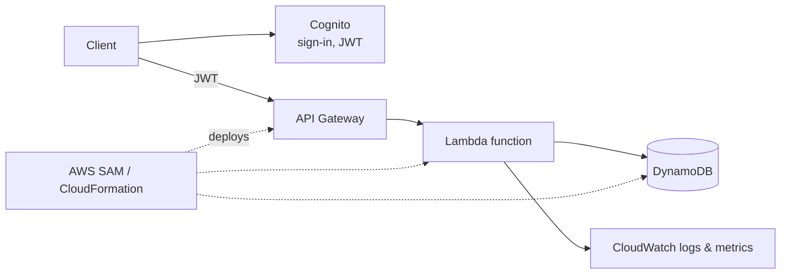

No servers to patch; you pay per request. Cold starts and execution time limits are the trade-offs.

---

## 15. Check yourself

1. What is the difference between continuous delivery and continuous deployment?
2. Why does a multi-stage Dockerfile produce a smaller, safer image?
3. A Pod is `CrashLoopBackOff`. What are your first four commands?
4. Readiness vs liveness probe: what happens when each fails?
5. Why must Terraform state be remote and locked in a team?
6. Why does a private subnet need a NAT gateway, and what does it cost?
7. Why is GitOps "pull" safer than CI "push" to the cluster?
8. When would you choose canary over blue/green?
