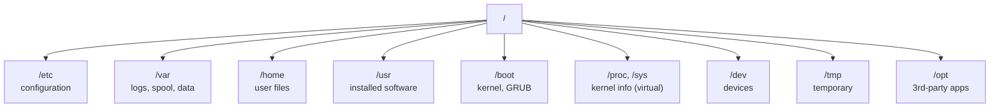
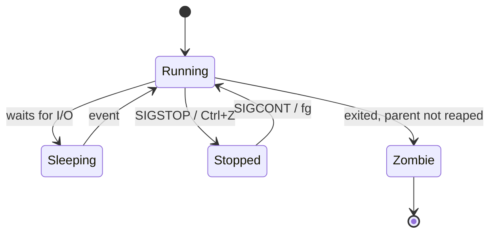
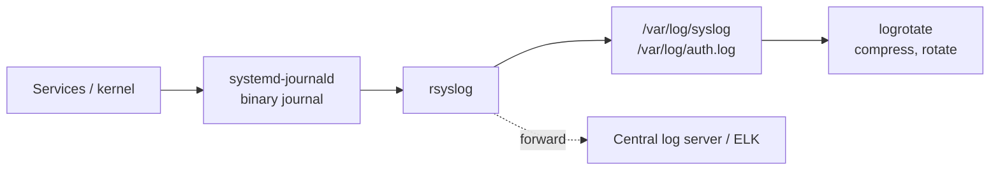
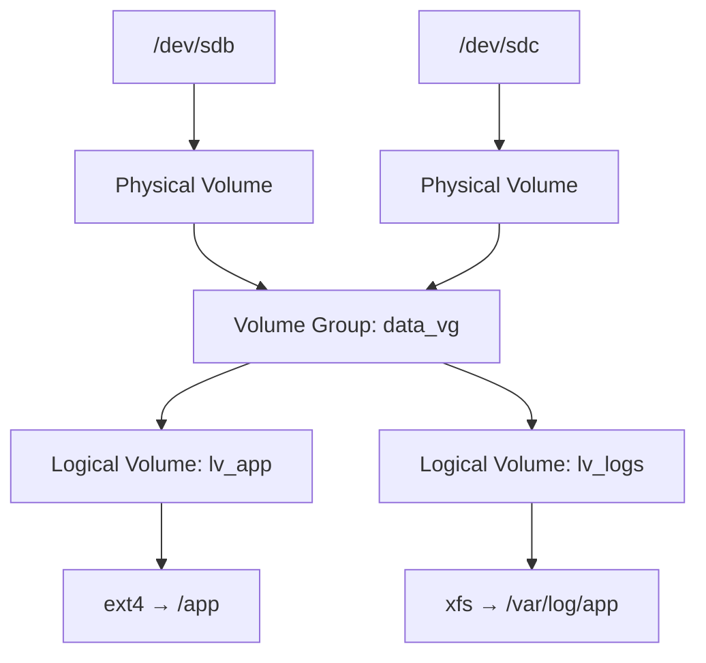
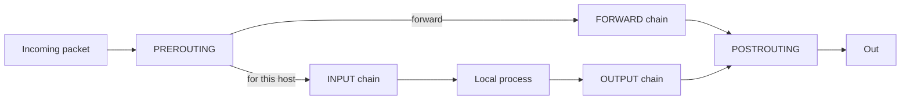
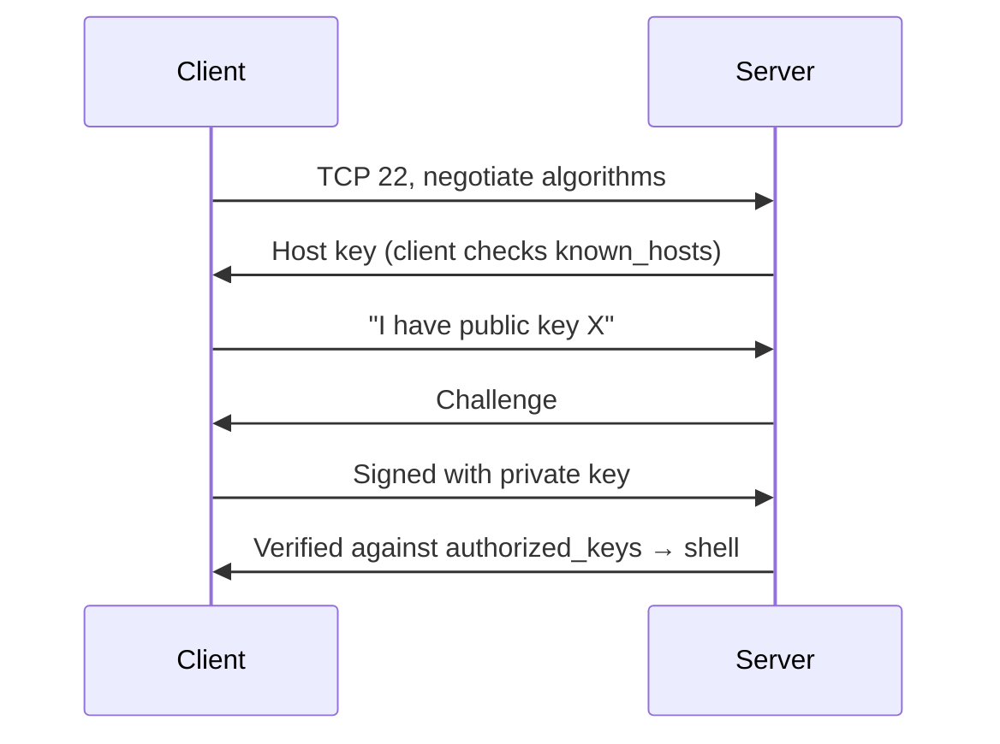
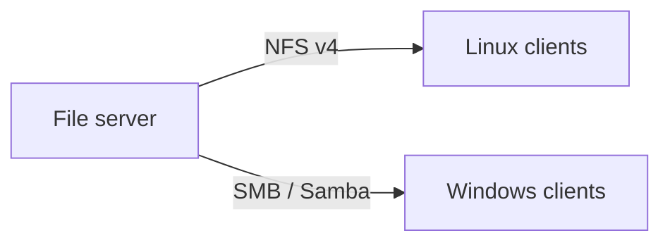

# 02 · Linux Administration

Practical Linux system administration notes, from how the machine boots to how it is backed up. Tested on Ubuntu and RHEL-family VMs in my home lab.

**Contents**
1. [Boot process](#1-boot-process)
2. [Filesystem hierarchy](#2-filesystem-hierarchy)
3. [Users, groups and permissions](#3-users-groups-and-permissions)
4. [Package management](#4-package-management)
5. [Processes](#5-processes)
6. [systemd services](#6-systemd-services)
7. [Logging](#7-logging)
8. [Storage, partitions and LVM](#8-storage-partitions-and-lvm)
9. [Networking](#9-networking)
10. [Firewalls](#10-firewalls)
11. [SSH](#11-ssh)
12. [Backups with rsync and cron](#12-backups-with-rsync-and-cron)
13. [File sharing: NFS and Samba](#13-file-sharing-nfs-and-samba)
14. [Troubleshooting playbook](#14-troubleshooting-playbook)
15. [Check yourself](#15-check-yourself)

---

## 1. Boot process


```bash
systemctl get-default                  # multi-user.target = no GUI
systemd-analyze blame                  # which units slowed the boot
journalctl -b -p err                   # errors from this boot
```

---

## 2. Filesystem hierarchy



Everything is a file: disks are `/dev/sda`, processes are `/proc/<pid>`.

---

## 3. Users, groups and permissions

```bash
sudo useradd -m -s /bin/bash -G developers alice   # create user with home dir
sudo passwd alice
sudo usermod -aG sudo alice                         # add to group (-a = append!)
id alice                                            # uid, gid, groups
sudo chage -M 90 alice                              # password expires after 90 days
```

Key files: `/etc/passwd` (accounts), `/etc/shadow` (password hashes), `/etc/group`, `/etc/sudoers` (edit only with `visudo`).

### Permission model

```
-rwxr-x---  1 alice developers  deploy.sh
 │└┬┘└┬┘└┬┘
 │ │  │  └── others: ---  (0)
 │ │  └───── group:  r-x  (5)
 │ └──────── owner:  rwx  (7)
 └────────── type: - file, d directory, l link
```

| Bit | File | Directory |
|---|---|---|
| r (4) | read content | list names |
| w (2) | modify | create/delete entries |
| x (1) | execute | enter (`cd`) |

```bash
chmod 750 deploy.sh            # rwx r-x ---
chmod g+w shared/              # add group write
chown alice:developers file
chmod g+s /srv/project         # SGID: new files inherit the group
chmod +t /srv/tmp              # sticky: only owner can delete
umask                          # default mask, 022 → files 644, dirs 755
setfacl -m u:bob:r report.txt  # ACL for one extra user
```

---

## 4. Package management

| Task | Debian/Ubuntu | RHEL/Rocky |
|---|---|---|
| Refresh index | `apt update` | `dnf makecache` |
| Install | `apt install nginx` | `dnf install nginx` |
| Upgrade all | `apt upgrade` | `dnf upgrade` |
| Remove | `apt remove nginx` | `dnf remove nginx` |
| Which package owns a file | `dpkg -S /usr/bin/curl` | `rpm -qf /usr/bin/curl` |

---

## 5. Processes



```bash
ps aux --sort=-%mem | head     # top memory users
top / htop                     # live view; load average = runnable + waiting tasks
pgrep -a nginx
kill -15 <pid>                 # SIGTERM: ask to stop cleanly
kill -9 <pid>                  # SIGKILL: last resort
nice -n 10 ./job.sh            # lower priority
renice -n 5 -p <pid>
lsof -i :8080                  # who is using port 8080
```

---

## 6. systemd services

```ini
# /etc/systemd/system/myapp.service
[Unit]
Description=My application
After=network-online.target

[Service]
User=myapp
ExecStart=/opt/myapp/bin/server --port 8080
Restart=on-failure
RestartSec=5
# sandboxing
NoNewPrivileges=true
ProtectSystem=strict
PrivateTmp=true

[Install]
WantedBy=multi-user.target
```

```bash
sudo systemctl daemon-reload            # after editing unit files
sudo systemctl enable --now myapp       # start now and at boot
systemctl status myapp
systemctl list-units --failed
systemctl list-timers                   # systemd's replacement for cron
```

---

## 7. Logging



```bash
journalctl -u nginx --since "1 hour ago"
journalctl -f                         # follow, like tail -f
journalctl -p warning -b              # warnings and worse this boot
tail -f /var/log/auth.log             # SSH logins, sudo use
grep "Failed password" /var/log/auth.log | wc -l
```

---

## 8. Storage, partitions and LVM

LVM puts a flexible layer between disks and filesystems, so volumes can grow without repartitioning.



```bash
lsblk                                   # disks and partitions
sudo pvcreate /dev/sdb /dev/sdc
sudo vgcreate data_vg /dev/sdb /dev/sdc
sudo lvcreate -n lv_app -L 10G data_vg
sudo mkfs.ext4 /dev/data_vg/lv_app
sudo mkdir /app && sudo mount /dev/data_vg/lv_app /app
echo '/dev/data_vg/lv_app /app ext4 defaults 0 2' | sudo tee -a /etc/fstab
sudo lvextend -r -L +5G /dev/data_vg/lv_app   # grow volume AND filesystem online
df -h ; du -sh /var/* | sort -h               # usage
```

---

## 9. Networking

```bash
ip -br a                         # interfaces and IPs
ip route                         # routing table, default gateway
ss -tulpn                        # listening ports and owning processes
ping -c 3 8.8.8.8                # L3 reachability
tracepath example.com            # path to host
dig example.com +short           # DNS lookup (see 05-how-dns-works.md)
curl -I https://example.com      # HTTP check
nmcli con mod eth0 ipv4.addresses 192.168.10.20/24 ipv4.gateway 192.168.10.1 \
      ipv4.dns 192.168.10.10 ipv4.method manual && nmcli con up eth0
```

**Layered troubleshooting:** link up? → IP and route? → gateway pingable? → DNS resolves? → port open? → application answers?

---

## 10. Firewalls



```bash
# ufw (Ubuntu, simple front-end)
sudo ufw default deny incoming
sudo ufw allow 22/tcp
sudo ufw allow from 192.168.10.0/24 to any port 3306
sudo ufw enable && sudo ufw status numbered

# iptables (low level)
sudo iptables -A INPUT -m state --state ESTABLISHED,RELATED -j ACCEPT
sudo iptables -A INPUT -p tcp --dport 22 -j ACCEPT
sudo iptables -P INPUT DROP
sudo iptables -L -n -v

# firewalld (RHEL)
sudo firewall-cmd --permanent --add-service=http && sudo firewall-cmd --reload
```

---

## 11. SSH



```bash
ssh-keygen -t ed25519 -C "bilal@laptop"
ssh-copy-id admin@server
```

Hardening in `/etc/ssh/sshd_config`:

```
PermitRootLogin no
PasswordAuthentication no
AllowGroups ssh-users
MaxAuthTries 3
```

Then `sudo systemctl reload sshd` (keep a second session open while testing).

---

## 12. Backups with rsync and cron

```bash
rsync -avh --delete /srv/data/ backup@nas:/backups/data/   # mirror, only changed files
rsync -avh --link-dest=/backups/daily.1 /srv/data/ /backups/daily.0/   # space-saving snapshots
```

```
# crontab -e   (min hour dom mon dow command)
30 2 * * *  /usr/local/bin/backup.sh >> /var/log/backup.log 2>&1
```

**3-2-1 rule:** 3 copies, on 2 media types, 1 off-site. A backup is only real once a restore has been tested.

---

## 13. File sharing: NFS and Samba



```bash
# NFS server
echo '/srv/share 192.168.10.0/24(rw,sync,no_root_squash)' | sudo tee -a /etc/exports
sudo exportfs -ra && sudo systemctl enable --now nfs-server
# NFS client
sudo mount -t nfs 192.168.10.5:/srv/share /mnt/share

# Samba share (/etc/samba/smb.conf)
# [team]
#   path = /srv/team
#   valid users = @team
#   read only = no
sudo smbpasswd -a alice && sudo systemctl restart smbd
```

---

## 14. Troubleshooting playbook

| Symptom | First checks |
|---|---|
| Disk full | `df -h`, `du -sh /var/* \| sort -h`, `journalctl --vacuum-size=500M` |
| High load | `top`, `vmstat 1`, `iostat -x 1` (CPU or I/O wait?) |
| Service won't start | `systemctl status`, `journalctl -u <svc> -n 50` |
| Can't connect | `ss -tulpn`, firewall rules, `curl localhost:<port>` |
| Out of memory | `free -h`, `dmesg \| grep -i oom` |
| Login fails | `/var/log/auth.log`, `chage -l <user>`, `faillock --user <user>` |

---

## 15. Check yourself

1. What does PID 1 do and why does it matter?
2. Why must `usermod -G` almost always be `usermod -aG`?
3. A directory has `r--` but not `x`. What can a user do?
4. How do you grow a full `/app` filesystem on LVM without downtime?
5. SIGTERM vs SIGKILL: why try one before the other?
6. Why disable password authentication for SSH?
