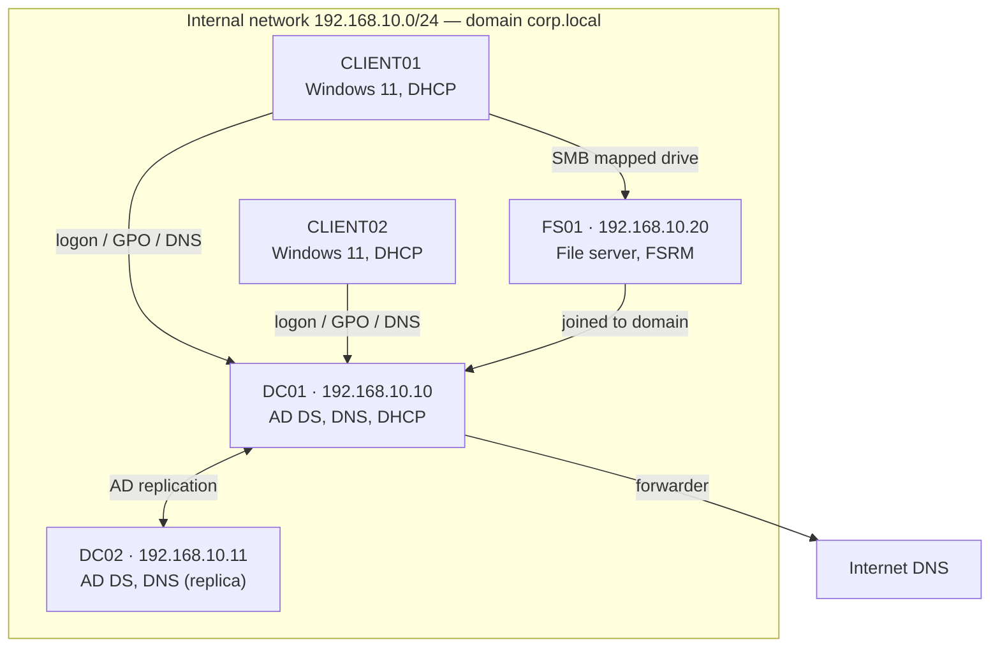
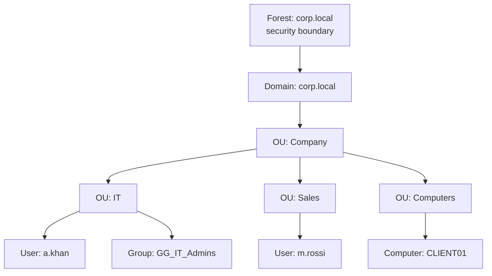
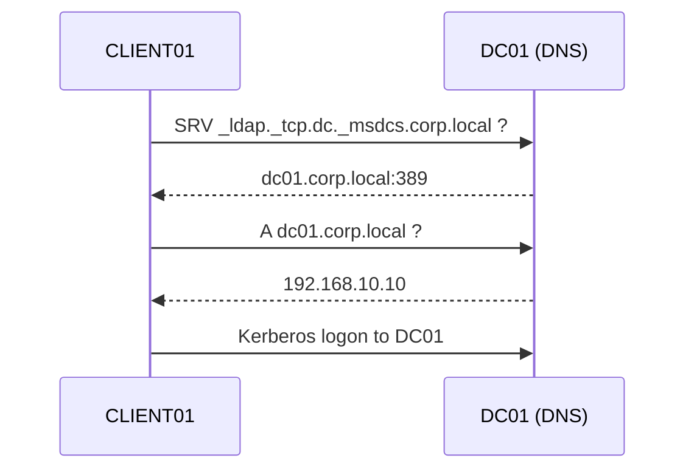
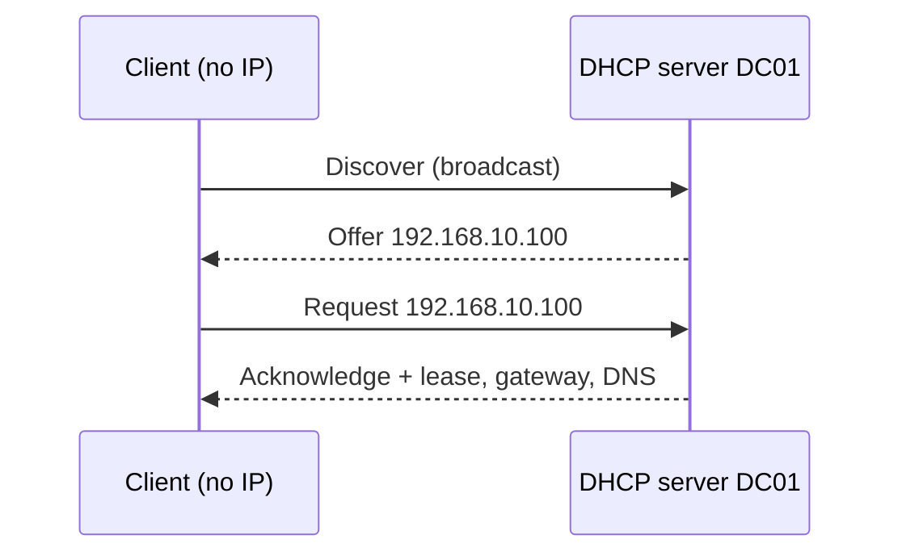
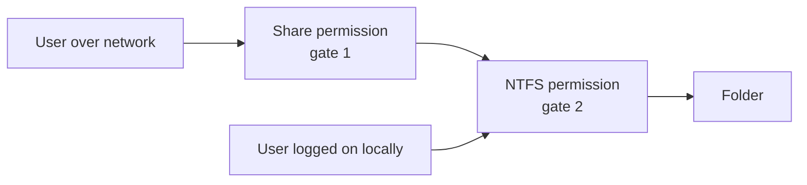
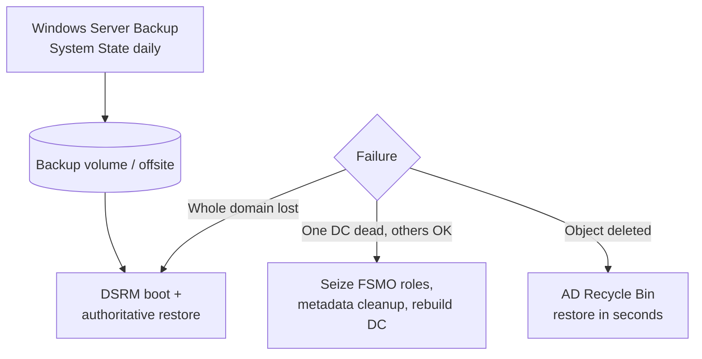

# 03 · Windows Server Administration

Notes from building a Windows Server domain from scratch in VMs: Active Directory, Group Policy, DNS, DHCP, file services and disaster recovery. Every step has a GUI path and the PowerShell equivalent.

**Contents**
1. [Lab architecture](#1-lab-architecture)
2. [Active Directory concepts](#2-active-directory-concepts)
3. [Promoting the first domain controller](#3-promoting-the-first-domain-controller)
4. [OUs, users and groups](#4-ous-users-and-groups)
5. [Group Policy](#5-group-policy)
6. [DNS on Windows Server](#6-dns-on-windows-server)
7. [DHCP](#7-dhcp)
8. [File services](#8-file-services)
9. [Disaster recovery](#9-disaster-recovery)
10. [Troubleshooting](#10-troubleshooting)
11. [Check yourself](#11-check-yourself)

---

## 1. Lab architecture



Built in VMware Workstation with an isolated virtual network; DC01 hands out addresses so clients find the domain automatically.

---

## 2. Active Directory concepts



| Term | Meaning |
|---|---|
| Domain | Shared database of users, computers and policies |
| Domain Controller | Server holding a writable copy of AD; authenticates logons (Kerberos) |
| Forest / tree | Collection of domains that trust each other |
| OU | Folder for objects; where you **link GPOs** and **delegate** admin rights |
| Group | Collection of users; where you **grant permissions** |
| FSMO roles | Five single-master roles (e.g. PDC Emulator for time and password changes) |
| Global Catalog | Partial copy of every object in the forest for fast searches |

**Group strategy AGDLP:** **A**ccounts go into **G**lobal groups (by role), which go into **D**omain **L**ocal groups (by resource), which get **P**ermissions.

---

## 3. Promoting the first domain controller

Before promoting: static IP, DNS pointing to itself, meaningful hostname.

```powershell
Rename-Computer -NewName DC01 -Restart
New-NetIPAddress -InterfaceAlias Ethernet0 -IPAddress 192.168.10.10 -PrefixLength 24 -DefaultGateway 192.168.10.1
Set-DnsClientServerAddress -InterfaceAlias Ethernet0 -ServerAddresses 127.0.0.1

Install-WindowsFeature AD-Domain-Services -IncludeManagementTools
Install-ADDSForest -DomainName corp.local -DomainNetbiosName CORP -InstallDns
# Prompts for the DSRM (Directory Services Restore Mode) password, then reboots
```

GUI: *Server Manager → Add Roles and Features → AD DS → Promote this server to a domain controller → Add a new forest*.

Verify: `Get-ADDomain`, `dcdiag /v`, and the `_ldap._tcp.dc._msdcs.corp.local` SRV records in DNS.

---

## 4. OUs, users and groups

```powershell
New-ADOrganizationalUnit -Name Company -Path "DC=corp,DC=local"
"IT","Sales","Computers" | ForEach-Object {
  New-ADOrganizationalUnit -Name $_ -Path "OU=Company,DC=corp,DC=local"
}

New-ADUser -Name "Ali Khan" -SamAccountName a.khan -UserPrincipalName a.khan@corp.local `
  -Path "OU=IT,OU=Company,DC=corp,DC=local" -Enabled $true `
  -AccountPassword (Read-Host -AsSecureString "Password") -ChangePasswordAtLogon $true

New-ADGroup -Name GG_IT_Admins -GroupScope Global -GroupCategory Security -Path "OU=IT,OU=Company,DC=corp,DC=local"
Add-ADGroupMember GG_IT_Admins -Members a.khan

# Bulk create from CSV (Name,Sam,OU)
Import-Csv users.csv | ForEach-Object {
  New-ADUser -Name $_.Name -SamAccountName $_.Sam -Path $_.OU -Enabled $true `
    -AccountPassword (ConvertTo-SecureString "Welcome!2024" -AsPlainText -Force) -ChangePasswordAtLogon $true
}

Unlock-ADAccount a.khan
Set-ADAccountPassword a.khan -Reset
Search-ADAccount -LockedOut
```

Join a client: `Add-Computer -DomainName corp.local -Restart`, then move it to `OU=Computers`.

---

## 5. Group Policy

### Processing order: LSDOU


Later layers override earlier ones unless a GPO is **Enforced** or an OU has **Block Inheritance**. Computer settings apply at boot, user settings at logon; both refresh every ~90 minutes.

### Policies I configured

| GPO | Linked to | Setting path |
|---|---|---|
| Password policy | Domain | Computer → Policies → Windows Settings → Security Settings → Account Policies → Password Policy (length 12, complexity, max age 90 days) |
| Account lockout | Domain | … Account Policies → Account Lockout Policy (5 attempts, 15 min) |
| Drive mapping | OU Sales | User → Preferences → Windows Settings → Drive Maps (`S:` → `\\FS01\Sales`) |
| Desktop restrictions | OU Sales | User → Policies → Administrative Templates → Control Panel (prohibit access), Desktop (lock wallpaper) |
| USB storage block | OU Computers | Computer → Policies → Administrative Templates → System → Removable Storage Access → *All removable storage classes: Deny all access* |

> Password and lockout policies only take effect from a GPO linked at the **domain** level (for per-group rules use Fine-Grained Password Policies).

```powershell
New-GPO -Name "Sales - Drive Map" | New-GPLink -Target "OU=Sales,OU=Company,DC=corp,DC=local"
gpupdate /force                 # on the client
gpresult /r                     # which GPOs applied, and which were filtered
gpresult /h report.html         # full HTML report
```

---

## 6. DNS on Windows Server

AD **depends** on DNS: clients find domain controllers by querying SRV records.



- **AD-integrated zones** replicate with AD and allow secure dynamic updates.
- **Forward lookup zone** (name → IP), **reverse lookup zone** (IP → name, `10.168.192.in-addr.arpa`).
- **Forwarders** send unknown names (internet) to an upstream resolver.

```powershell
Add-DnsServerPrimaryZone -NetworkId "192.168.10.0/24" -ReplicationScope Domain
Add-DnsServerResourceRecordA -ZoneName corp.local -Name intranet -IPv4Address 192.168.10.30
Set-DnsServerForwarder -IPAddress 1.1.1.1, 8.8.8.8
Resolve-DnsName dc01.corp.local
```

Full theory in [05 · How DNS Works](05-how-dns-works.md).

---

## 7. DHCP

### DORA



```powershell
Install-WindowsFeature DHCP -IncludeManagementTools
Add-DhcpServerInDC -DnsName dc01.corp.local -IPAddress 192.168.10.10   # authorize in AD
Add-DhcpServerv4Scope -Name "LAN" -StartRange 192.168.10.100 -EndRange 192.168.10.200 -SubnetMask 255.255.255.0
Set-DhcpServerv4OptionValue -ScopeId 192.168.10.0 -Router 192.168.10.1 -DnsServer 192.168.10.10 -DnsDomain corp.local
Add-DhcpServerv4Reservation -ScopeId 192.168.10.0 -IPAddress 192.168.10.50 -ClientId "00-15-5D-01-02-03" -Name printer
Get-DhcpServerv4Lease -ScopeId 192.168.10.0
```

Clients renew at 50% of the lease. An address starting `169.254.x.x` (APIPA) means the client got no DHCP answer.

---

## 8. File services

### Share vs NTFS permissions



Over the network the **most restrictive** of the two wins. Best practice: share = *Authenticated Users: Full Control*, then control everything with NTFS.

| NTFS permission | Allows |
|---|---|
| Read | Open and view |
| Read & execute | Plus run programs |
| Modify | Plus change and delete |
| Full control | Plus change permissions and take ownership |

Explicit **Deny** beats Allow; explicit permissions beat inherited ones.

```powershell
New-Item -Path D:\Shares\Sales -ItemType Directory
New-SmbShare -Name Sales -Path D:\Shares\Sales -FullAccess "CORP\Authenticated Users"
icacls D:\Shares\Sales /inheritance:r /grant "CORP\DL_Sales_Modify:(OI)(CI)M" /grant "CORP\Domain Admins:(OI)(CI)F"
```

### File Server Resource Manager (FSRM)

```powershell
Install-WindowsFeature FS-Resource-Manager -IncludeManagementTools
New-FsrmQuota -Path D:\Shares\Sales -Size 5GB -Description "Hard quota"   # hard: blocks writes
New-FsrmFileScreen -Path D:\Shares\Sales -Template "Block Audio and Video Files"
```

- **Hard quota** stops writes at the limit; **soft quota** only notifies.
- **File screening** blocks file types (e.g. `.mp4`, `.exe`) and can email the admin.

---

## 9. Disaster recovery



```powershell
# Enable AD Recycle Bin (one-time, forest-wide)
Enable-ADOptionalFeature 'Recycle Bin Feature' -Scope ForestOrConfigurationSet -Target corp.local
Get-ADObject -Filter 'samaccountname -eq "m.rossi"' -IncludeDeletedObjects | Restore-ADObject

# System State backup
Install-WindowsFeature Windows-Server-Backup
wbadmin start systemstatebackup -backupTarget:E: -quiet

# Health
repadmin /replsummary
netdom query fsmo
```

**Key ideas:** always run at least two DCs; back up System State; keep the DSRM password safe; test restores in an isolated network.

---

## 10. Troubleshooting

| Symptom | Check |
|---|---|
| Client can't join domain | Client DNS must point to the DC, not the router; `nslookup corp.local` |
| GPO not applied | `gpresult /r`, OU placement, security filtering, link enabled, `gpupdate /force` |
| User locked out repeatedly | Event ID 4740 on the PDC Emulator, old saved credentials on phone/drives |
| No IP (169.254.x.x) | DHCP service running, scope active, server authorized |
| Access denied on share | Effective Access tab, nested groups, user must log off/on after group change |
| Replication issues | `repadmin /showrepl`, `dcdiag`, time sync (Kerberos allows 5 min skew) |

---

## 11. Check yourself

1. Why must domain clients use the DC as their DNS server?
2. In what order are GPOs applied, and how can a parent GPO always win?
3. Where do you link a password policy for it to work, and why?
4. A user has Share: Read and NTFS: Modify. What can they do over the network?
5. Explain AGDLP with an example.
6. What does a `169.254.x.x` address tell you?
