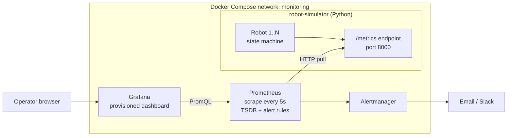
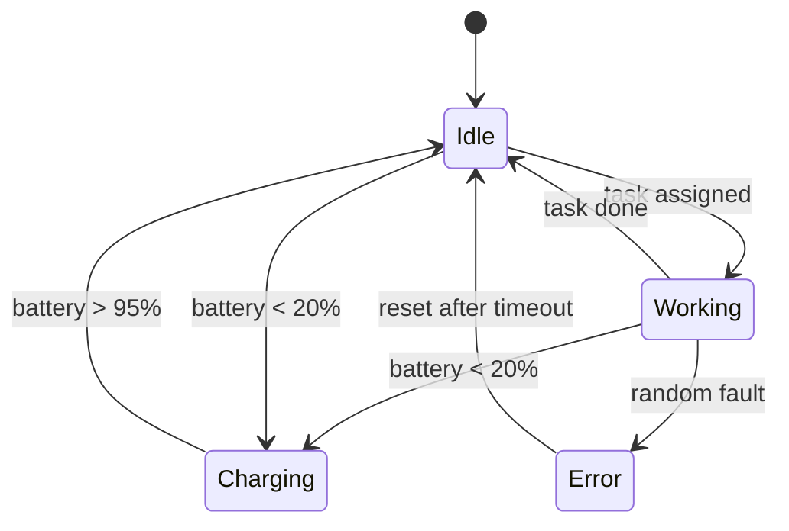
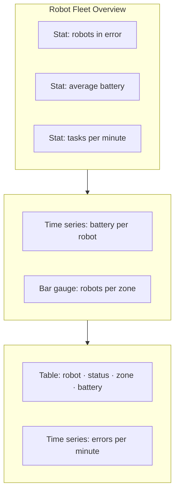

# 04 · Robot Fleet Monitoring

A monitoring stack for a simulated fleet of warehouse robots. A Python service generates telemetry for each robot, Prometheus scrapes and stores it, Grafana visualises it and alert rules flag problems. Everything starts with one `docker compose up`.

> Also published as an article on Medium.

**Contents**
1. [Problem](#1-problem)
2. [Architecture](#2-architecture)
3. [Telemetry model](#3-telemetry-model)
4. [Metric generator](#4-metric-generator)
5. [Prometheus configuration and alerts](#5-prometheus-configuration-and-alerts)
6. [Grafana dashboard](#6-grafana-dashboard)
7. [Running it](#7-running-it)
8. [What I learned](#8-what-i-learned)
9. [Next steps](#9-next-steps)

---

## 1. Problem

An operations team running dozens of autonomous robots needs to answer, at a glance:

- Which robots are **low on battery** and should go to charge?
- Which robots are **in an error state** right now, and since when?
- **Where** is the fleet working (which zones are busy or empty)?
- Is the fleet getting better or worse over the shift?

## 2. Architecture



| Component | Role | Port |
|---|---|---|
| robot-simulator | Generates telemetry and exposes it in Prometheus format | 8000 |
| Prometheus | Pulls and stores time series, evaluates alert rules | 9090 |
| Alertmanager | Groups and routes alerts | 9093 |
| Grafana | Dashboards, provisioned from files | 3000 |

**Why pull, not push?** Prometheus decides the scrape rate, can tell immediately when a target is down (`up == 0`), and the robots need no knowledge of the monitoring system.

## 3. Telemetry model



| Metric | Type | Labels | Meaning |
|---|---|---|---|
| `robot_battery_percent` | Gauge | `robot_id` | Battery level 0–100 |
| `robot_status` | Gauge | `robot_id`, `status` | 1 for the current status, 0 for the others |
| `robot_error_state` | Gauge | `robot_id` | 1 if in error |
| `robot_location_zone` | Gauge | `robot_id`, `zone` | 1 for the zone the robot is in |
| `robot_tasks_completed_total` | Counter | `robot_id` | Tasks finished since start |
| `robot_errors_total` | Counter | `robot_id` | Faults since start |

Labels are kept low-cardinality (fixed robots, statuses and zones) so Prometheus stays fast.

## 4. Metric generator

```python
# simulator/app.py
import random, time
from prometheus_client import Gauge, Counter, start_http_server

ROBOTS   = [f"robot-{i:02d}" for i in range(1, 11)]
STATUSES = ["idle", "working", "charging", "error"]
ZONES    = ["inbound", "storage", "picking", "outbound"]

battery  = Gauge("robot_battery_percent", "Battery level", ["robot_id"])
status_g = Gauge("robot_status", "Current status (1 = active)", ["robot_id", "status"])
error_g  = Gauge("robot_error_state", "1 if robot is in error", ["robot_id"])
zone_g   = Gauge("robot_location_zone", "Current zone (1 = here)", ["robot_id", "zone"])
tasks    = Counter("robot_tasks_completed_total", "Completed tasks", ["robot_id"])
errors   = Counter("robot_errors_total", "Faults", ["robot_id"])

state = {r: {"battery": random.uniform(40, 100), "status": "idle", "zone": random.choice(ZONES)} for r in ROBOTS}

def step(robot):
    s = state[robot]
    if s["status"] == "working":
        s["battery"] -= random.uniform(0.5, 1.5)
        if random.random() < 0.02:
            s["status"] = "error"; errors.labels(robot).inc()
        elif random.random() < 0.15:
            s["status"] = "idle"; tasks.labels(robot).inc()
        elif random.random() < 0.10:
            s["zone"] = random.choice(ZONES)
    elif s["status"] == "idle":
        s["battery"] -= 0.1
        if random.random() < 0.5:
            s["status"] = "working"
    elif s["status"] == "charging":
        s["battery"] += 3
        if s["battery"] >= 95:
            s["status"] = "idle"
    elif s["status"] == "error" and random.random() < 0.1:
        s["status"] = "idle"
    if s["battery"] < 20 and s["status"] in ("idle", "working"):
        s["status"] = "charging"
    s["battery"] = max(0, min(100, s["battery"]))

def export(robot):
    s = state[robot]
    battery.labels(robot).set(round(s["battery"], 1))
    error_g.labels(robot).set(1 if s["status"] == "error" else 0)
    for st in STATUSES:
        status_g.labels(robot, st).set(1 if s["status"] == st else 0)
    for z in ZONES:
        zone_g.labels(robot, z).set(1 if s["zone"] == z else 0)

if __name__ == "__main__":
    start_http_server(8000)
    while True:
        for r in ROBOTS:
            step(r); export(r)
        time.sleep(2)
```

```dockerfile
# simulator/Dockerfile
FROM python:3.12-slim
WORKDIR /app
RUN pip install --no-cache-dir prometheus-client
COPY app.py .
USER nobody
EXPOSE 8000
CMD ["python", "app.py"]
```

## 5. Prometheus configuration and alerts

```yaml
# prometheus/prometheus.yml
global:
  scrape_interval: 5s
rule_files: [alerts.yml]
alerting:
  alertmanagers: [{ static_configs: [{ targets: ["alertmanager:9093"] }] }]
scrape_configs:
  - job_name: robots
    static_configs: [{ targets: ["robot-simulator:8000"] }]
```

```yaml
# prometheus/alerts.yml
groups:
  - name: robot-fleet
    rules:
      - alert: RobotBatteryCritical
        expr: robot_battery_percent < 10
        for: 1m
        labels: { severity: warning }
        annotations: { summary: "{{ $labels.robot_id }} battery at {{ $value }}%" }
      - alert: RobotStuckInError
        expr: robot_error_state == 1
        for: 2m
        labels: { severity: critical }
        annotations: { summary: "{{ $labels.robot_id }} in error for over 2 minutes" }
      - alert: SimulatorDown
        expr: up{job="robots"} == 0
        for: 30s
        labels: { severity: critical }
```

`for:` avoids alerting on short blips: the condition must hold for the whole window.

## 6. Grafana dashboard



| Panel | PromQL |
|---|---|
| Robots in error | `sum(robot_error_state)` |
| Average battery | `avg(robot_battery_percent)` |
| Tasks per minute | `sum(rate(robot_tasks_completed_total[1m])) * 60` |
| Robots per zone | `sum by (zone) (robot_location_zone)` |
| Fleet by status | `sum by (status) (robot_status)` |
| Errors per minute | `sum(rate(robot_errors_total[5m])) * 60` |

Data source and dashboard are **provisioned from files**, so a fresh `docker compose up` comes up fully configured, no clicking.

## 7. Running it

```yaml
# docker-compose.yml
services:
  robot-simulator:
    build: ./simulator
    ports: ["8000:8000"]
  prometheus:
    image: prom/prometheus:v2.53.0
    volumes: ["./prometheus:/etc/prometheus", "prom-data:/prometheus"]
    ports: ["9090:9090"]
    depends_on: [robot-simulator]
  alertmanager:
    image: prom/alertmanager:v0.27.0
    ports: ["9093:9093"]
  grafana:
    image: grafana/grafana:11.1.0
    environment: { GF_SECURITY_ADMIN_PASSWORD: "${GRAFANA_PASSWORD:-change-me}" }
    volumes: ["./grafana/provisioning:/etc/grafana/provisioning", "grafana-data:/var/lib/grafana"]
    ports: ["3000:3000"]
    depends_on: [prometheus]
volumes: { prom-data: {}, grafana-data: {} }
```

```bash
docker compose up -d --build
curl -s localhost:8000/metrics | grep robot_battery   # raw metrics
# Prometheus: http://localhost:9090  →  Status → Targets shows "robots" UP
# Grafana:    http://localhost:3000  →  Robot Fleet Overview
docker compose down -v
```

## 8. What I learned

- Choosing the **right metric type**: gauges for things that go up and down (battery), counters for things that only grow (tasks), and `rate()` to turn counters into speeds.
- **Label design** decides Prometheus performance; unbounded labels (timestamps, IDs per request) would explode the number of series.
- **Provisioning as code** for Grafana makes the stack reproducible.
- Alerts need a `for:` duration and should describe a **symptom an operator can act on**.

## 9. Next steps

- Deploy on Kubernetes with the kube-prometheus-stack Helm chart and a `ServiceMonitor`.
- Route alerts to Slack via Alertmanager receivers.
- Add logs (Loki) to correlate errors with events.
- Replace the simulator with MQTT messages from real devices.
