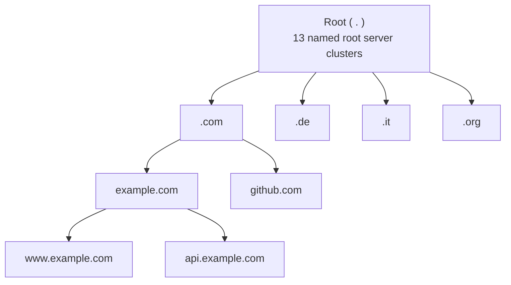
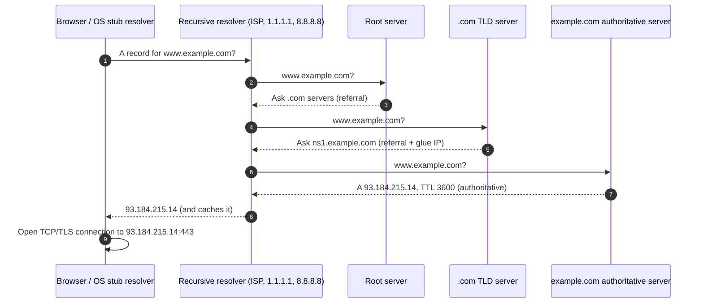
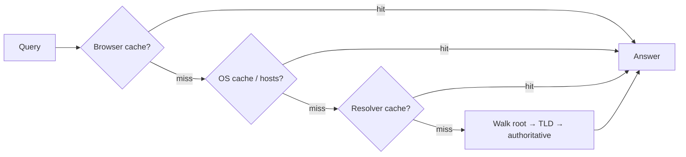
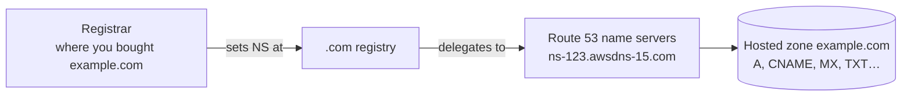
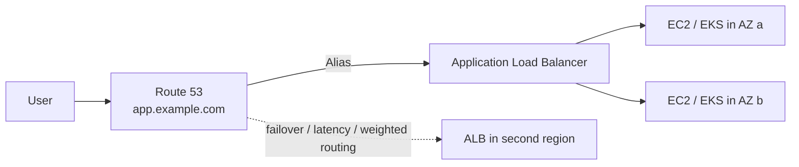
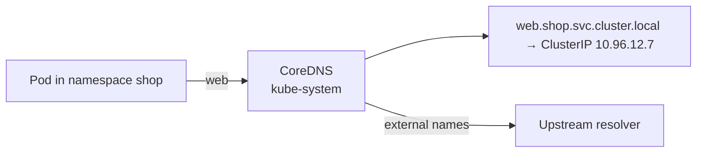
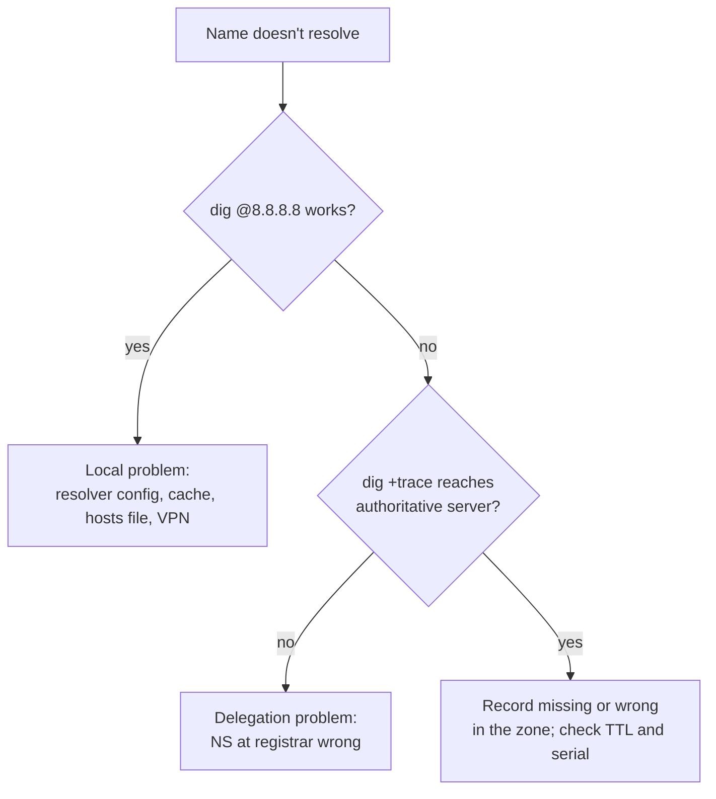

# 05 · How DNS Works

DNS (Domain Name System) is the internet's phone book: it turns names people remember (`github.com`) into IP addresses computers route to (`140.82.121.4`). Almost every outage story eventually says "it was DNS", so understanding it is essential for DevOps.

**Contents**
1. [The hierarchy](#1-the-hierarchy)
2. [A lookup step by step](#2-a-lookup-step-by-step)
3. [Who is who: resolvers and servers](#3-who-is-who-resolvers-and-servers)
4. [Record types](#4-record-types)
5. [Caching and TTL](#5-caching-and-ttl)
6. [Zones, delegation and authority](#6-zones-delegation-and-authority)
7. [DNS in DevOps platforms](#7-dns-in-devops-platforms)
8. [Security](#8-security)
9. [Troubleshooting toolkit](#9-troubleshooting-toolkit)
10. [Check yourself](#10-check-yourself)

---

## 1. The hierarchy

DNS is a distributed tree. No single server knows everything; each level knows who is responsible for the level below.



A fully qualified name is read right to left: `www.example.com.` → root `.` → TLD `com` → domain `example` → host `www`.

---

## 2. A lookup step by step

What happens when you type `www.example.com` in a browser with nothing cached:



Before step 1 the client checks, in order: **browser cache → OS cache → `/etc/hosts` (or `C:\Windows\System32\drivers\etc\hosts`)**. Only on a miss does it ask the resolver.

- The client makes a **recursive** query ("give me the final answer").
- The resolver makes **iterative** queries ("tell me the answer or who to ask next").
- DNS uses **UDP 53** normally and **TCP 53** for large responses and zone transfers.

---

## 3. Who is who: resolvers and servers

| Role | Job | Examples |
|---|---|---|
| Stub resolver | Library in the OS that sends the question | `systemd-resolved`, Windows DNS Client |
| Recursive resolver | Walks the tree on your behalf and caches answers | ISP resolver, Cloudflare 1.1.1.1, Google 8.8.8.8, a DC's DNS |
| Root server | Points to TLD servers | a.root-servers.net … m.root-servers.net |
| TLD server | Points to the domain's authoritative servers | Verisign for `.com`, DENIC for `.de` |
| Authoritative server | Holds the real records for a zone | Route 53, Cloudflare DNS, Windows DNS, BIND |
| Forwarder | Sends queries it can't answer to another resolver | Windows DC forwarding internet names to 1.1.1.1 |

---

## 4. Record types

| Type | Maps | Example |
|---|---|---|
| **A** | Name → IPv4 | `www  A  93.184.215.14` |
| **AAAA** | Name → IPv6 | `www  AAAA  2606:2800:21f:cb07::1` |
| **CNAME** | Name → another name (alias) | `shop  CNAME  myshop.herokudns.com` |
| **MX** | Domain → mail servers, with priority | `@  MX 10 mail1.example.com` |
| **TXT** | Free text: SPF, DKIM, domain verification | `@  TXT "v=spf1 include:_spf.google.com -all"` |
| **NS** | Zone → its authoritative servers | `@  NS  ns1.example.com` |
| **SOA** | Zone metadata: primary server, serial, timers | one per zone |
| **PTR** | IP → name (reverse DNS) | `14.215.184.93.in-addr.arpa PTR www.example.com` |
| **SRV** | Service → host and port | `_ldap._tcp.dc._msdcs.corp.local SRV 0 100 389 dc01` |
| **CAA** | Which CAs may issue TLS certificates | `@ CAA 0 issue "letsencrypt.org"` |

**Rules worth remembering**
- A CNAME cannot sit at the zone apex (`example.com` itself) and cannot coexist with other records on the same name. Cloud DNS solves this with **ALIAS / Route 53 Alias** records.
- MX and NS must point to names, never to IPs or CNAMEs.

---

## 5. Caching and TTL



Every record carries a **TTL** (time to live, in seconds). Caches keep the answer until it expires.

- **Long TTL** (e.g. 86400): fewer queries, faster, but changes spread slowly.
- **Short TTL** (e.g. 60): changes visible quickly, more query load.
- **Migration trick:** lower the TTL a day *before* changing an IP, make the change, then raise it again.
- **Negative caching:** "this name doesn't exist" (NXDOMAIN) is cached too, for the SOA's minimum TTL.

"DNS propagation" is really just old cached answers expiring around the world.

---

## 6. Zones, delegation and authority

A **zone** is the part of the namespace one set of servers is authoritative for. A parent zone **delegates** a child by publishing NS records for it.



Example zone file (BIND format):

```
$TTL 3600
@     IN SOA ns1.example.com. admin.example.com. (
            2026101801 ; serial – increase on every change
            7200       ; refresh – secondaries check this often
            900        ; retry
            1209600    ; expire
            300 )      ; negative-cache TTL
@     IN NS    ns1.example.com.
@     IN NS    ns2.example.com.
@     IN A     93.184.215.14
www   IN CNAME example.com.
api   IN A     10.0.11.25
@     IN MX 10 mail.example.com.
```

Primary servers hold the editable copy; secondaries copy it via **zone transfer** (AXFR/IXFR). In Windows AD, zones replicate through AD itself instead.

---

## 7. DNS in DevOps platforms

### AWS Route 53



- **Public hosted zone**: answers the internet. **Private hosted zone**: answers only inside chosen VPCs.
- **Routing policies**: simple, weighted (canary releases), latency-based, failover (with health checks), geolocation.
- Inside a VPC the resolver lives at the VPC CIDR base **+2** (e.g. `10.0.0.2`).

### Kubernetes (CoreDNS)



Every Service gets `<service>.<namespace>.svc.cluster.local`. A Pod's `/etc/resolv.conf` has search domains, so plain `web` works inside the same namespace and `web.shop` from another.

### Active Directory

Clients find domain controllers through SRV records such as `_ldap._tcp.dc._msdcs.corp.local`. If a client uses a public resolver instead of the DC, domain join and logon fail. See [03 · Windows Server](03-windows-server-administration.md#6-dns-on-windows-server).

### Docker

Containers on a user-defined network resolve each other by container or service name through Docker's embedded DNS at `127.0.0.11`.

---

## 8. Security

| Threat | What it is | Defence |
|---|---|---|
| Cache poisoning | Forged answers injected into a resolver cache | **DNSSEC** (signed records), source-port randomisation |
| Eavesdropping | Queries visible on the network | **DoT** (DNS over TLS, port 853), **DoH** (DNS over HTTPS) |
| DDoS on DNS | Authoritative servers overwhelmed | Anycast providers, multiple NS on different networks |
| Subdomain takeover | CNAME left pointing at a deleted cloud resource | Remove stale records when resources are deleted |
| Email spoofing | Others send mail as your domain | SPF, DKIM, DMARC TXT records |

---

## 9. Troubleshooting toolkit

```bash
dig www.example.com                     # full answer with TTL and server used
dig +short www.example.com A
dig +trace www.example.com              # walk root → TLD → authoritative yourself
dig @1.1.1.1 www.example.com            # ask a specific resolver
dig example.com MX / NS / TXT / SOA
dig -x 93.184.215.14                    # reverse lookup
nslookup www.example.com 8.8.8.8
resolvectl status                       # which resolver Linux is using
resolvectl flush-caches
```

```powershell
Resolve-DnsName www.example.com -Type A
Resolve-DnsName www.example.com -Server 1.1.1.1
ipconfig /displaydns
ipconfig /flushdns
```

```bash
# Inside Kubernetes
kubectl run tmp --rm -it --image=busybox:1.36 -- nslookup web.shop.svc.cluster.local
kubectl -n kube-system logs -l k8s-app=kube-dns
```

**Decision flow**



| Answer | Meaning |
|---|---|
| `NOERROR` with records | Works |
| `NXDOMAIN` | Name does not exist |
| `SERVFAIL` | Resolver couldn't get an answer (often DNSSEC or dead authoritative servers) |
| `REFUSED` | Server won't answer you (not authoritative, recursion disabled) |

---

## 10. Check yourself

1. Walk through every step of resolving `api.example.com` from an empty cache.
2. Recursive vs iterative query: who does which?
3. Why can't you put a CNAME on `example.com` itself, and how does Route 53 work around it?
4. You changed an A record an hour ago and some users still see the old IP. Why, and what should you have done?
5. How does a Pod reach `postgres` in another namespace?
6. Why does a Windows client pointing at 8.8.8.8 fail to join the domain?
