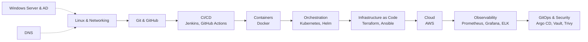

# DevOps Knowledge Base

Structured engineering notes written during my **DevOps internship at Valaxy Technologies (Mar–Nov 2024)** and my own home-lab practice afterwards. Each document explains *why* a tool exists, *how* it works under the hood, and the commands I actually use, with architecture diagrams where a picture explains more than text.

> These notes are the theory behind the hands-on work in this repository (see [LabOps](../README.md)).

## Contents

| # | Document | What it covers |
|---|---|---|
| 01 | [DevOps Course Notes](01-devops-course-notes.md) | The full DevOps lifecycle: Git, CI/CD with Jenkins, Docker, Kubernetes, Terraform on AWS, monitoring, GitOps, deployment strategies |
| 02 | [Linux Administration](02-linux-administration.md) | Boot process, filesystem, users and permissions, processes and systemd, logging, storage and LVM, networking, firewalls, SSH, backups, NFS/Samba |
| 03 | [Windows Server Administration](03-windows-server-administration.md) | Active Directory from scratch, OUs, users and groups, Group Policy, DNS and DHCP, file services with NTFS permissions and FSRM, disaster recovery |
| 04 | [Robot Fleet Monitoring](04-robot-fleet-monitoring.md) | Project write-up: simulated robot telemetry exported to Prometheus and visualised in Grafana with Docker Compose |
| 05 | [How DNS Works](05-how-dns-works.md) | Resolution step by step, record types, caching and TTL, DNS in AWS, Kubernetes and Active Directory, troubleshooting |

## Learning roadmap

## How to read these notes

- **Concept first** – every section starts with the problem the tool solves.
- **Diagrams** – rendered by GitHub with Mermaid, no images needed.
- **Commands** – copy-paste ready, with a comment on what each one does.
- **Check yourself** – each document ends with interview-style questions.
