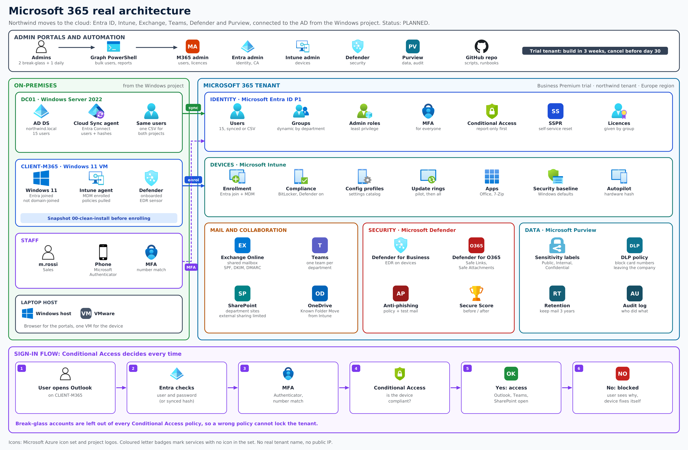
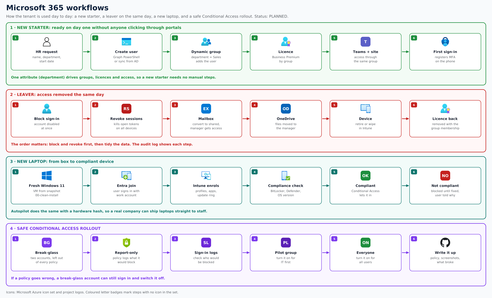

# Microsoft 365: Northwind in the cloud

**Status: planned, after the Windows Admin project.** Built on a Microsoft 365 Business Premium trial tenant and one Windows 11 VM. Screenshots and results will be added phase by phase.

Northwind must be able to answer "yes" to a customer's security questions: Do you use MFA? Are your devices managed? Can you stop data leaving the company? Can you remove a leaver's access the same day?

## Architecture

- **Identity:** Entra ID P1 with 15 users, dynamic groups, group-based licences, least-privilege admin roles, two break-glass accounts, MFA and Conditional Access.
- **Devices:** Intune enrolment, compliance, configuration profiles, update rings, apps and a security baseline for the Windows 11 VM.
- **Mail and collaboration:** Exchange Online with SPF, DKIM and DMARC, Teams and SharePoint per department, OneDrive.
- **Security and data:** Defender for Business and for Office 365, Purview sensitivity labels, DLP, retention and audit.
- **Hybrid identity:** the AD from the Windows Admin project syncs to Entra ID with Cloud Sync.

## Workflows

## Phases

| # | Phase |
|---|---|
| 1 | Tenant, break-glass accounts, admin roles, users and groups |
| 2 | MFA and Conditional Access (report-only first) |
| 3 | Exchange Online and email authentication |
| 4 | Teams, SharePoint and OneDrive |
| 5 | Intune: enrolment, compliance, profiles, updates, apps |
| 6 | Defender |
| 7 | Purview: labels, DLP, retention, audit |
| 8 | Joiner and leaver automation |
| 9 | Hybrid identity with the Windows Admin AD |
| 10 | Acceptance test and write-up |
| 11 | Cancel the trial before it ends |
