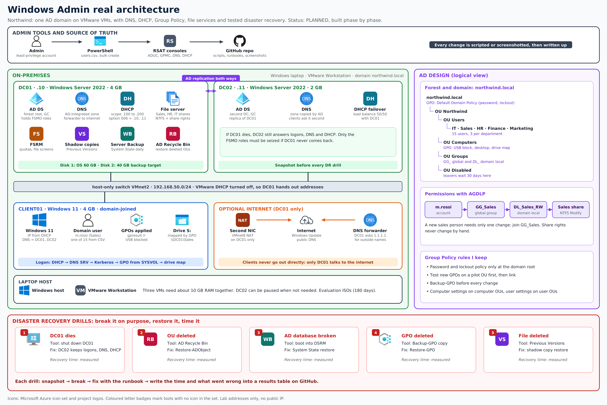
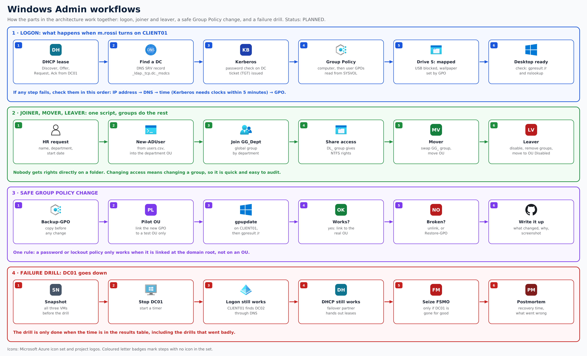

# Windows Admin: Northwind on Windows Server

**Status: planned.** This is the design I am building in VMware. Screenshots and measured results will be added phase by phase.

Northwind needs one identity for everyone, machines that find each other by name and get addresses automatically, every PC set up the same way, a controlled file share, and a way to survive a dead server, a deleted OU, a broken GPO or a deleted file.

## Architecture

- **DC01** runs AD DS, DNS, DHCP, the file server with FSRM, shadow copies and Windows Server Backup to a second disk.
- **DC02** is a second domain controller with DNS and a DHCP failover partner, so logons keep working if DC01 dies.
- **CLIENT01** is a domain-joined Windows 11 PC that gets its address from DHCP and its settings from Group Policy.
- Only DC01 has a second network card to the internet, for Windows Update and as a DNS forwarder.

## Workflows

## Phases

| # | Phase | Proof |
|---|---|---|
| 1 | Domain controller and forest | `Get-ADDomain`, screenshots |
| 2 | DNS: zones, records, forwarder, break-fix drill | `nslookup`, `Resolve-DnsName` |
| 3 | DHCP: scope, options, failover with DC02 | lease on CLIENT01 |
| 4 | Client join and logon | `whoami`, `nltest /dsgetdc` |
| 5 | Users from CSV, OUs, AGDLP groups, Group Policy | `gpresult /r` |
| 6 | Second domain controller | `repadmin /replsummary` |
| 7 | File services: shares, NTFS, FSRM, shadow copies | access test per group |
| 8 | Disaster recovery: five timed drills | results table below |
| 9 | Acceptance test and write-up | checklist |

## Disaster recovery results

| # | Drill | Recovery time | Notes |
|---|---|---|---|
| 1 | DC01 shut down | _to measure_ | |
| 2 | OU deleted, AD Recycle Bin | _to measure_ | |
| 3 | AD database broken, System State restore | _to measure_ | |
| 4 | GPO deleted, Restore-GPO | _to measure_ | |
| 5 | File deleted, Previous Versions | _to measure_ | |
